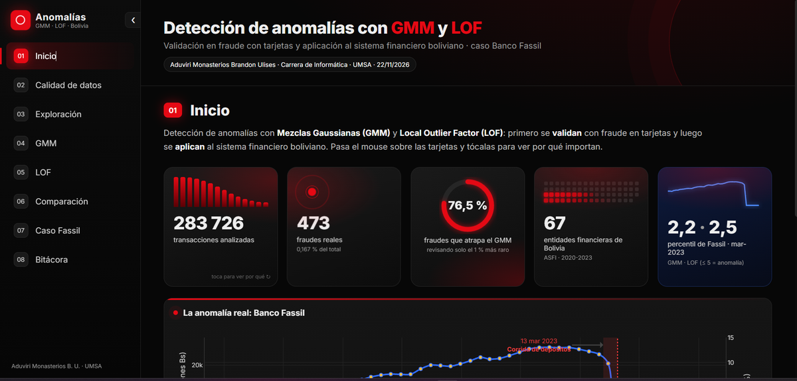
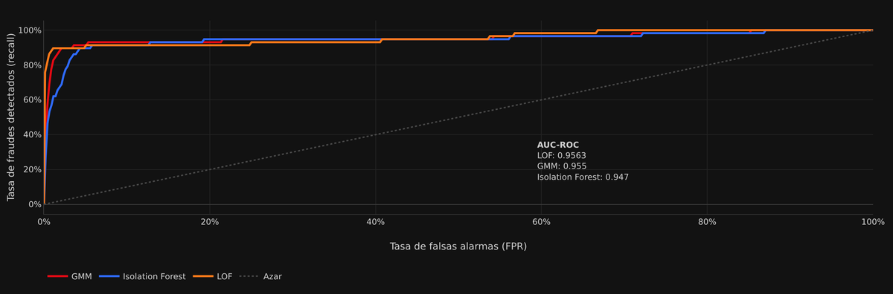
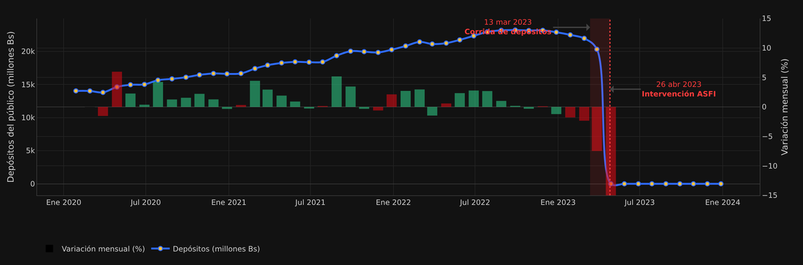
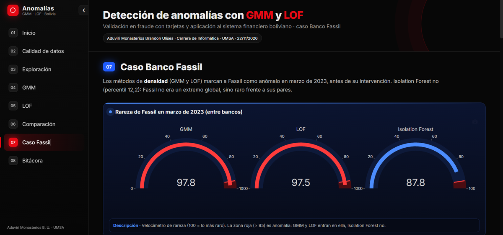

# Detección de anomalías con GMM y LOF · Fraude con tarjetas y caso Banco Fassil (Bolivia)

Trabajo individual de detección de anomalías con **Modelos de Mezclas Gaussianas (GMM)** y **Local Outlier Factor (LOF)**, usando **Isolation Forest** como referencia. El proyecto está hecho en **R / RStudio** e incluye bitácora, dashboard interactivo e informe en PDF.

**Autor:** Aduviri Monasterios Brandon Ulises · Carrera de Informática, UMSA · La Paz – Bolivia, 2026

🔗 **Dashboard en línea:** `https://<tu-usuario>.github.io/<nombre-del-repo>/`
📄 **Informe:** [informe/AduviriMonasteriosBrandonUlisesGMM.pdf](informe/AduviriMonasteriosBrandonUlisesGMM.pdf)



---

## Objetivo

1. **Validar** GMM y LOF en un dataset etiquetado: *Credit Card Fraud Detection* (284 807 transacciones, 0,17 % de fraude).
2. **Aplicarlos a datos de Bolivia**: estados financieros mensuales de 67 entidades supervisadas por la ASFI (2020–2023). El foco es comprobar si los modelos marcan como anómalo al **Banco Fassil** antes de su intervención (26 de abril de 2023).

## Resultados principales

### Validación · creditcard (umbral del 1 %)

| Modelo | Fraudes detectados | Recall | AUC-ROC | AUC-PR |
|---|---|---|---|---|
| GMM (VVI, 9 componentes) | 362 / 473 | 76,5 % | 0,957 | 0,281 |
| LOF (k = 100, muestra de 40 000) | 51 / 58 | 87,9 % | 0,956 | 0,475 |
| Isolation Forest (referencia) | 264 / 473 | 55,8 % | 0,949 | 0,119 |

- LOF depende mucho de **k**: con k = 5 su AUC-ROC es 0,52 y con k = 100 sube a 0,96, porque los fraudes forman pequeños grupos.



### Aplicación · sistema financiero boliviano (ASFI)

- 3 312 filas depuradas a 2 758 (67 entidades), en dos niveles: sistema (8 indicadores) y bancos (4 indicadores).
- 13 observaciones entidad-mes fueron marcadas por los tres modelos a la vez.
- **Banco Fassil, marzo de 2023:** GMM lo ubica en el percentil 4,0 de densidad (sistema) y LOF en el 6,4. Ese mes los depósitos cayeron 7,5 %, un mes antes de la intervención.



> Nota: desde mayo de 2023 la cuenta 210 cae entre 35 y 40 % en casi todos los bancos. Lo más probable es que sea un cambio de registro; se explica en las limitaciones del informe.

## Estructura del repositorio

```
GMM/
├── GMMAnomalias.R          # Script completo por bloques (0 a 7B)
├── GMM.Rproj               # Proyecto de RStudio
├── data/
│   ├── dataBaseByEntidad.xlsx
│   └── LEEME.md            # Cómo obtener creditcard.csv
├── bitacora/bitacora.csv   # Registro de cada decisión del análisis
├── output/tablas/          # Tablas de resultados (CSV)
├── docs/index.html         # Dashboard interactivo (GitHub Pages)
├── informe/                # Informe final en PDF (APA 7)
└── img/                    # Imágenes de este README
```

## Cómo ejecutarlo

1. Clona el repositorio y abre `GMM.Rproj` en RStudio.
2. Descarga `creditcard.csv` (ver [data/LEEME.md](data/LEEME.md)) y colócalo en `data/`.
3. Abre `GMMAnomalias.R` y ejecuta cada bloque en orden: selecciónalo y presiona **Ctrl + Enter**. El Bloque 0 instala los paquetes que falten.
4. Al final se generan `output/`, `bitacora/bitacora.csv` y `dashboard/Dashboard_GMM_LOF.html`.

**Paquetes principales:** `mclust`, `dbscan`, `isotree`, `pROC`, `data.table`, `readxl`, `dplyr`, `plotly`, `DT`, `htmltools`.

## Bloques del script

| Bloque | Contenido |
|---|---|
| 0 | Configuración, paquetes, semilla y bitácora |
| 1 | Carga y perfil de los datos |
| 2 | Calidad de datos y limpieza |
| 3 | Transformaciones y variables derivadas |
| 4 | GMM (selección por BIC, puntaje de log-densidad) |
| 5 | LOF (efecto de k) |
| 6 | Isolation Forest y comparación de modelos |
| 7 / 7B | Dashboard interactivo |



## Referencias de datos

- Dal Pozzolo, A. et al. (2015). *Credit Card Fraud Detection*. ULB Machine Learning Group, Kaggle.
- Autoridad de Supervisión del Sistema Financiero (ASFI). Estados financieros por entidad, 2020–2023.
